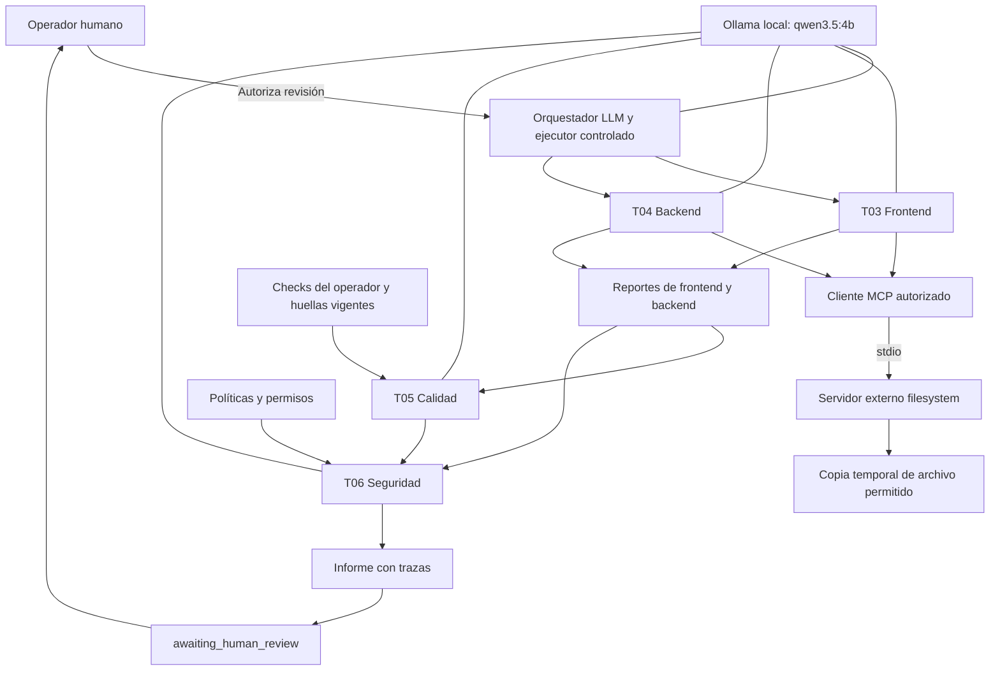
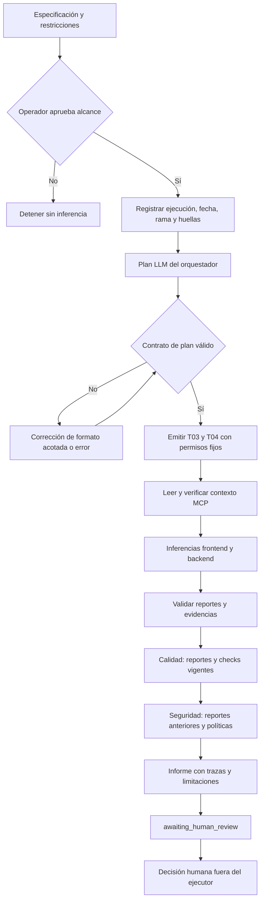

# Taller 5: arquitectura, flujo y seguridad

Versión documental 2.0.0. Rama: `taller5/sistema-agentes`. Los resultados ejecutados se consultan en `resultados.md` y los artefactos de evidencia.

## Estructura

El modelo propone un plan estructurado y hallazgos; el ejecutor controla contratos, herramientas y secuencia. Frontend/backend reciben código obtenido por MCP. Calidad recibe sus reportes y checks ligados al código vigente. Seguridad recibe políticas y reportes anteriores. Los cinco roles usan el mismo modelo local, con contextos y responsabilidades separados; no se afirma diversidad de modelos.

## Roles y límites

| Rol | Modelo asignado | Responsabilidad | Permisos |
|---|---|---|---|
| Orquestador | `qwen3.5:4b` | Plan estructurado y delegaciones | No amplía roles, rutas ni herramientas |
| Frontend, T03 | `qwen3.5:4b` | React, filtros, accesibilidad, API y demostración | Solo contexto frontend asignado y MCP de lectura |
| Backend, T04 | `qwen3.5:4b` | FastAPI, validaciones, contratos y datos en memoria | Solo contexto backend asignado y MCP de lectura |
| Calidad, T05 | `qwen3.5:4b` | Contrastar reportes anteriores y pruebas | No ejecuta shell ni inventa comandos o resultados |
| Seguridad, T06 | `qwen3.5:4b` | Revisar permisos, fronteras y reportes previos | No amplía políticas ni modifica código |

La configuración ejecutable reside en `agents/manifest.v1.json`. Ollama se consulta localmente en `http://127.0.0.1:11434`. Asignar un modelo no demuestra ejecución: solo las trazas auténticas permiten afirmar que respondió. El modo sin `--llm` sigue siendo inventario determinista y no se presenta como inferencia.

## Flujo real

Los reintentos limitados por `max_correction_rounds` corrigen formato de respuesta, no código turístico. Un fallo agotado es un error explícito. `--approved` registra una declaración del operador vinculada a la ejecución y sus huellas; no autentica identidad ni constituye firma humana. El cierre no aprueba automáticamente publicación, commit ni push.

## MCP y fronteras de seguridad

El cliente inicia `@modelcontextprotocol/server-filesystem@2.3.0` por `stdio` usando Node portátil `24.13.0`. Cada sesión recibe una copia temporal de un archivo permitido. Se inicializa MCP, descubren herramientas, invoca `read_text_file`, compara contenido y verifica rechazo de lectura del original fuera del scope. En modo LLM ese contenido llega a los especialistas.

El servidor anuncia escrituras que el cliente no autoriza. El staging no es sandbox OS: Node conserva permisos del usuario. No se afirma protección completa frente a un servidor malicioso, conexión con IDE o PostgreSQL. Código y respuestas LLM son datos no confiables; no pueden aprobar acciones ni alterar permisos.

Las fuentes adicionales autorizadas se entregan como extractos de hasta 4000 caracteres por archivo. `context_receipts` registra qué extractos llegaron al modelo y cuáles se truncaron. Los hashes de `evidence` inventarían archivos del host; no demuestran lectura integral por el LLM. Los archivos main de frontend/backend se entregan completos mediante MCP. La evaluación valida estabilidad del código y de los bytes de checks desde el inicio hasta el cierre.

Las rutas y herramientas se autorizan por rol. Los reportes deben corresponder a tareas emitidas y agentes asignados; `inspected` requiere evidencia no vacía, sin duplicados y con hashes correctos. Los checks registran fecha y huellas: un resultado antiguo no acredita código nuevo. El operador ejecuta comandos fijos; no hay shell disponible para modelos. La compilación no sustituye navegador o accesibilidad manual.

## Referencia pendiente

La rúbrica ponderada se conserva en `rubrica.md`. El sistema de referencia no está disponible; el usuario autorizó continuar marcando esa comparación como pendiente. Las mejoras respecto al inventario local anterior son comprobables, pero no son diferencias verificadas con una referencia desconocida.
