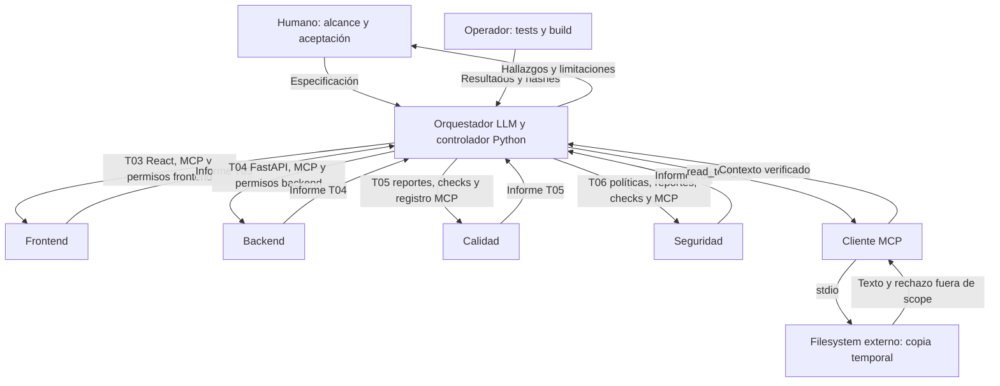
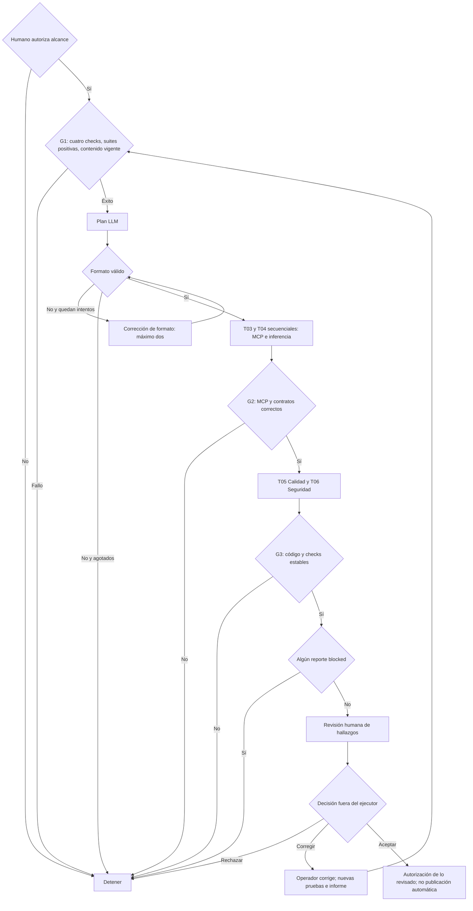
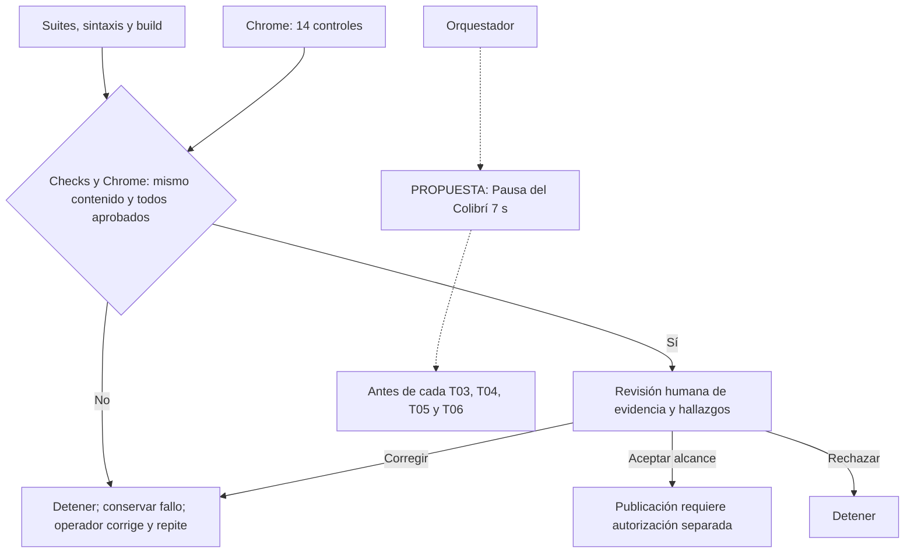

# Arquitectura corregida — Taller 5

Cinco roles reales, Qwen local y herramientas propias del controlador Python.
Tabla de entradas/salidas y permisos exactos: `agents/manifest.v1.json`.
No son permisos nativos de Copilot; aceptación de herramienta pendiente.

## Estructura

No existe comunicación lateral. El host controla secuencia, herramientas y contratos.
Solo frontend/backend reciben MCP; revisores reciben ambas verificaciones por el centro.
Las rutas permitidas son archivos exactos, no permisos recursivos de carpeta.

## Flujo

Timeout, modelo ausente y denegaciones inesperadas detienen sin respuestas prefijadas.
El formato tiene tres intentos totales; no hay autocorrección de código turístico.
`--approved` declara alcance, no autentica identidad ni acepta el plan generado.
Los hallazgos cierran en awaiting_human_findings_review; inspected no significa aprobado.

## Límites

El cliente MCP limita read_text_file; servidor con escrituras anunciadas no usadas.
Node conserva permisos del usuario: no sandbox OS. Ollama solo en loopback fijo.
Extractos de 4000 caracteres, main completo por MCP y recibos de truncamiento.
Hash del host no demuestra comprensión del modelo. No persiste PostgreSQL.
Pendientes: cronista-lunar, Pausa del Colibrí, escritura-orbital, ITC/MutaGato y R-27.
No existe confirmación docente acreditada para los diagramas.

## Mejora técnica: cierre conjunto y propuesta documental

Puerta CLI implementada: `agents.release_gate`. Antes de presentar una revisión,
exige checks y 14 controles Chrome aprobados con el mismo SHA/mapa de archivos.
Rechaza un navegador incompleto, fallido o de otro contenido. La salida válida es
ready_for_human_review; no firma aceptación ni protege main en GitHub.

La pausa es diseño, no está ejecutada y no se acredita el beneficio descrito por
el enunciado. Modelos y permisos no cambian. Oráculos fijos complementan el
contrato API: ids [6,5], total 135000 y saldo 65000 para el caso aprobado existente.
