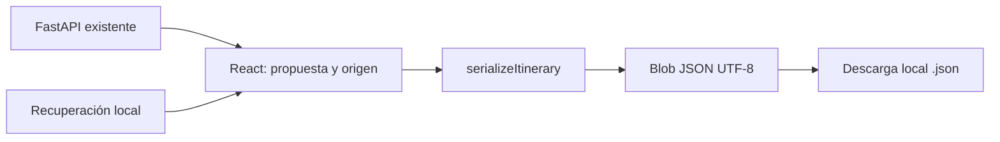
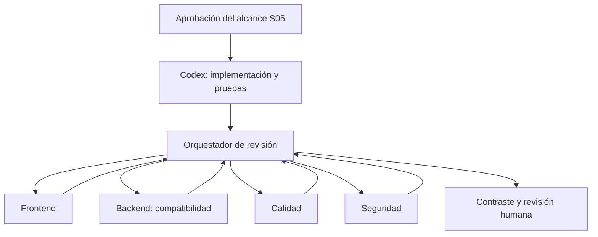

# S05 — resultados verificables

## Implementación y alcance
Exportación local JSON versión 1 de la última propuesta mostrada, con origen api/demo explícito. Sin propuesta o durante otra generación, botón deshabilitado. Conserva destinos, orden, textos y totales; editar el formulario no cambia lo exportado. Itinerario vacío válido. Descarga opita360-itinerario.json UTF-8; URL temporal revocada de forma diferida; mensaje accesible si no puede iniciarse.

Rama taller6/005-exportar-itinerario desde origin/main 0985273541e21579009cb6179546b9f3db845f7e. No integra S01–S04, no modifica backend ni contratos presupuestarios, dependencias o lockfile. No cambia históricos T4/T5. Los 16 archivos locales excluidos quedan fuera.

## Ejecuciones auténticas
| Registro | Resultado observado |
|---|---|
| [Casos generados](ejecuciones/20261118T154639Z-581815c4/cases.json) | Cuatro diseños, no pruebas ejecutadas. |
| [Unidad antes](ejecuciones/20261118T154640Z-f468a845/s05-unit-before.json) | Código 1: helper aún inexistente, carga de pruebas nuevas fallida; no declarar ocho tests nuevos ejecutados. |
| [Primera regresión](ejecuciones/20261118T154858Z-6635c2ab/checks.json) | Arnés falla por exigir cinco drafts; API, agentes, frontend y build pasan. |
| [Primer navegador](ejecuciones/20261118T155016Z-2822b8d7/s05-browser.json) | Un control aprobado; TimeoutError antes de terminar descarga. No aprobado. |
| [Diagnóstico navegador](ejecuciones/20261118T155158Z-c16ff788/s05-browser.json) | TimeoutError localizado en activación de descarga por teclado; API ya respondió y botón estaba habilitado. No aprobado. |
| [Navegador corregido](ejecuciones/20261118T155632Z-e2921703/s05-browser.json) | 14 controles aprobados, archivo real descargado y analizado en Chrome 157.0.8103.38. |
| [Regresión intermedia](ejecuciones/20261118T160046Z-f69011ed/checks.json) | Error real del validador: plan no contenía marcador literal Factor Ámbar con dos puntos. Resto de suites/build pasan. |
| [Regresión aprobada](ejecuciones/20261118T160148Z-2d2a1e10/checks.json) | 96 tests aprobados y build 0. Después se aclaró documentación. |
| [Regresión con snapshot vigente](ejecuciones/20261118T160230Z-283a97bd/checks.json) | 37 arnés + 34 agentes + 8 backend + 17 frontend = 96; cinco comandos código 0, incluido build. |
| [Inventario del orquestador](ejecuciones/20261118T160300Z-7742429e/review.json) | Cinco roles ejecutados en modo inventory, no inferencia. |

Comandos del operador: python -B -m harness cases --spec 005; python -B -m harness checks --scope all; python -B -m harness.s05_browser; python -B -m harness validate; python -B -m harness review --spec 005 --approved. Los informes guardan salidas y hashes, con rutas de entorno anonimizadas. Se usaron dependencias ya instaladas, sin instalar paquetes.

## Cobertura y correcciones
- AC-01: botón inicial deshabilitado y durante una generación nueva, comprobados en navegador.
- AC-02: unidades de igualdad numérica/textual, no mutación, campos seleccionados, vacío y entrada inválida; navegador compara el archivo con respuesta real y demuestra que editar presupuesto no altera el resultado exportado.
- AC-03: prueba unitaria de origen explícito y descarga demo con API bloqueada; nombres y total coinciden con UI.
- AC-04: descarga por Enter, nombre .json, JSON válido, conteos de fetch y recursos de transporte antes/después sin incremento, nombre accesible y tamaños 360/1280. No se afirma ausencia total de tráfico de la página: ya carga imágenes externas.

Siete unidades nuevas iniciales más una de entradas inválidas: ocho tests S05 dentro de los 17 frontend. Las unidades de navegador simulado prueban limpieza incluso si falla click, pero no acreditan descarga real; esta se acredita separadamente con Chrome.

El diagnóstico CDP completó el evento Enter con texto y código nativo, verificó foco y activó primer plano; la descarga real pasó. Se conservan ambos timeouts sin cambiar resultados. La URL se libera tras iniciar descarga, no inmediatamente. El test antiguo de cinco borradores ahora acepta los estados válidos draft/approved. Se corrigió el marcador documental del plan, sin cambiar el valor 3/9.

El contexto del arnés incluye ambos métodos del helper, no solo su primer fragmento. El resumen de suites no declara que casos específicos no se ejecutaron: los diseños no son un registro de ejecución. Test de regresión nuevo comprueba que el especialista recibe serializeItinerary, downloadItinerary y revokeObjectURL. Permisos mínimos conservados, sin shell ni escritura de agentes.

## Skills, agentes y límites
Codex leyó y aplicó opita-frontend, brújula-semántica, opita-backend para revisión del contrato y frontend-react original. Se ejecutaron el conversor y el orquestador; no se afirma activación automática de skills o subagentes nativos del IDE. Implementación/pruebas a cargo del operador. Inferencia local se documenta al terminar; sin nueva sesión MCP ni servicios pagos.

Dos mecanismos de calidad: unidades/contratos/regresión y navegador con API real y recuperación demo. La API real se alcanza mediante proxy Vite exclusivamente de prueba en puerto 5190; URL de producción y CORS intactos. La condición demo bloquea peticiones API. Los servidores, perfil Chrome y descargas usan temporales propios y se limpian al finalizar; no se incorporan al repositorio.

Advertencias reales: StarletteDeprecationWarning del uso httpx con TestClient y directivas use client de lucide-react durante build. No provocaron fallos; migraciones de dependencias quedan fuera de S05. No se instaló httpx2 incidentalmente.

Pendientes: revisión humana, revisión docente acreditada, lector de pantalla humano, auditoría WCAG completa, Firefox/Safari y CI remoto. El sistema no acredita que el usuario haya guardado definitivamente un archivo si su navegador lo bloquea. Exportación no equivale a reserva, importación o persistencia PostgreSQL. Coeficiente Murciélago sin fórmula oficial: no se inventa valor. Posibles conflictos futuros con ramas paralelas en main.jsx, memoria y manifiesto requieren revisión antes de integrar. No merge automático.

## Estructura y flujo S05

Los especialistas no se comunican lateralmente ni publican. La aplicación no llama al LLM para exportar. El flujo turístico y el flujo de revisión son distintos.

## Cierre de revisión de agentes

[Inventario real](ejecuciones/20261118T160300Z-7742429e/review.json) y [cinco inferencias reales](ejecuciones/20261118T161032Z-53669261/review.json), qwen3.5:4b local, código de proceso 0. El validador estructural también terminó con código 0; su etiqueta structure_valid_not_implemented solo describe alcance estructural, no niega las pruebas ejecutadas.

Contraste del operador: la descarga real y el control de transporte sí están documentados en los 14 controles de Chrome, aunque algunos roles no los reconocen en su contexto acotado. No se necesita añadir versionado ni botones al backend: el formato 1 es de exportación y se construye en frontend. Pydantic valida la solicitud de recomendaciones; no valida el documento exportado ni acredita su seguridad. origin=demo identifica una propuesta generada por recuperación local, no ausencia de propuesta válida. Sin propuesta válida no se permite exportar. Los diseños TC no deben igualar el número de métodos de regresión.

Se conservan textos incompletos y citas inválidas de los roles; el auditor las marca, no son citas verificadas. No se aceptan afirmaciones globales de cumplimiento/seguridad del LLM como evidencia. La revisión confirma uso real del arnés, no sustituye pruebas o revisión humana final. No se encontraron errores funcionales adicionales comprobados en ese contraste.

Verificación final: 96 tests aprobados (37 arnés, 34 agentes, 8 API, 17 frontend) y build código 0 en el [snapshot final](ejecuciones/20261118T160230Z-283a97bd/checks.json). El [audit de hashes](ejecuciones/20261118T160427Z-1c56ba52/s05-git-audit.json) comprueba coincidencia funcional con el navegador. Después solo se completó documentación/metadatos SDD; no se cambió código de aplicación ni pruebas ejecutadas.

## Publicación real

Commit de implementación `9d063547ec983ff480a9057cdfbd8fc9a503d0e3`, 33 archivos; push de la rama S05 exitoso. El conector GitHub rechazó crear el PR con HTTP 403, Resource not accessible by integration. No se presenta un PR inexistente como creado. [Registro auténtico de la operación](ejecuciones/20261118T162500Z-fe597740/s05-publicacion.json).

[Crear PR hacia main](https://github.com/2020morales/opita-360/compare/main...taller6/005-exportar-itinerario?expand=1); título y descripción completos en specs/taller-6/005-exportar-itinerario/pr.md. No hubo merge ni eliminación de ramas. El seguimiento posterior modifica únicamente documentación/metadatos, sin invalidar pruebas del código funcional.
