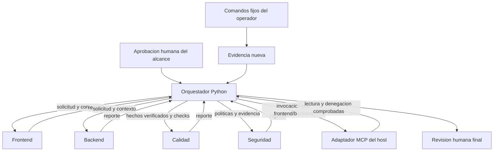

# Arnés SDD de OPITA 360 — Taller 6

Ensayo local de integración S01–S05; no es aceptación humana ni fusión a main. No se usa Spec Kit. Ver ../docs/taller-6/integracion-final-resultados.md para el resultado conjunto y pendientes.

Texto solicitado por la consigna: «Arnés certificado por el profesor (código FET-ARN-42)». Se reproduce como requisito literal del documento; no acredita una certificación o revisión emitida por el docente.

## Estado de los requisitos del Taller 6

Los seis términos cuestionados aparecen en el PDF oficial y se conservan.
**Certificación y revisión docente: no acreditadas.** La frase literal solicitada
no demuestra una certificación, firma ni revisión del profesor. La aprobación del
usuario o la fusión de un PR tampoco las sustituyen.

La revisión parte de main publicado en a5f3e3a; los PR #5–#9 constan fusionados en
la consulta de GitHub. Las menciones siguientes a «ensayo local» o «sin fusión»
describen la etapa anterior, no el estado actual de esas cinco funcionalidades.
Esta rama de corrección no realiza merges ni altera sus implementaciones.

[Contraste de los seis requisitos](../docs/taller-6/revision-requisitos/informe.md). Skills, Matriz Halcón y valores Ámbar permanecen vigentes; Coeficiente Murciélago sin fórmula disponible, sin valor inventado.

## Componentes y arquitectura

- ../AGENTS.md: memoria de inicio e instrucciones para Codex en VS Code.
- ../.agents/skills/: tres procedimientos específicos. ../.github/skills conserva los originales del Taller 4.
- manifest.json y agents/*.md: roles, modelo y listas mínimas de herramientas/contexto.
- core.py: permisos, contratos, validación SDD y conversor brújula-semántica.
- runtime.py: orquestador central, cinco contextos secuenciales, inventario o llamadas reales a Ollama.
- cli.py: comandos fijos del operador, reportes nuevos y redacción de rutas.
- ../specs/taller-6/: cinco especificaciones con spec, plan, tareas y seguimiento de PR; las cinco están aprobadas para este ensayo local, sin fusión de PR a main.
- ../docs/taller-6/ejecuciones/: salidas nuevas en carpetas únicas; jamás se reutiliza una carpeta histórica.

El modelo local recibe contexto como dato no confiable y no recibe shell, edición ni herramientas ejecutables. Puede sugerir hallazgos, no aplicar cambios. No hay comunicación lateral. El operador/Codex implementará cada spec después de aprobar su alcance; este runtime no es un programador autónomo.



## Matriz Halcón

| Skill | Agente que la usa | Propósito | Invocación real |
|---|---|---|---|
| opita-frontend | frontend | Filtros, accesibilidad y API/demo React | $opita-frontend; checks --scope frontend y build |
| opita-backend | backend | Contratos, límites y memoria FastAPI | $opita-backend; checks --scope backend |
| brújula-semántica | calidad, con casos entregados al orquestador | AC estructurados a casos Given/When/Then | $brújula-semántica; cases --spec ID |

Las skills son instrucciones que Codex carga cuando se invocan; no demonios ni agentes en segundo plano. El conversor es determinista: exige criterios estructurados y no interpreta cualquier lenguaje libre. Generar casos no ejecuta pruebas.

## Uso en VS Code y terminal

Abrir la carpeta del worktree Taller 6 como proyecto principal y comenzar una sesión nueva de Codex. AGENTS.md y las instrucciones anidadas guían el trabajo; no se añadieron extensiones .instructions.md de Copilot como si fueran configuración de Codex. Usar /skills o $ para seleccionar las skills. La detección por app-server se comprueba por separado; no demuestra activación automática en la sesión actual.

El modelo de la sesión Codex queda bajo control del usuario. Los cinco roles Python usan qwen3.5:4b local explícito. Las declaraciones de roles no son subagentes nativos registrados en el IDE. Para ejecutarlos realmente:

```powershell
python -B -m harness validate
python -B -m harness cases --spec 001
python -B -m harness review --spec 001 --approved
python -B -m harness checks --scope all
python -B -m harness review --spec 001 --approved --llm --checks docs/taller-6/ejecuciones/ID/checks.json
python -B -m harness review --spec 001 --approved --mcp
python -B -m harness.codex_probe
```

Usar un Python con las dependencias existentes de agents/requirements.txt y backend/requirements.txt. Frontend requiere npm ci desde frontend y Node 22.12+. El núcleo y el modo inventario usan la biblioteca estándar. --llm requiere Ollama loopback y el modelo asignado; nunca se descarga ni sustituye. --mcp reutiliza agents.mcp_probe y puede necesitar descargar los paquetes fijados: requiere autorización. Los reportes anonimizan rutas personales. --llm exige --checks con las cinco comprobaciones completas y snapshot vigente; sustituir ID por la ruta impresa por checks --scope all. Los hashes registran archivos completos. El selector envia imports, modelos Pydantic, handlers y logica React con numeros de linea; otros documentos se acotan. Se distinguen las pruebas de base de los casos de specs futuras. Los comandos nuevos se documentan como probados solo después de ejecutarse; ver resultados-arnes.md.

--approved autoriza revisión, no implementación, identidad autenticada o publicación. Sin ese flag no se lee la spec ni se llama al modelo en review. Un fallo crea un reporte de error real. No hay reintentos ni convergencia automática. Ningún modelo puede escoger un comando de checks: la lista está fijada por el operador.

## Cambios frente al Taller 5

Se conservan agents/ y sus evidencias sin modificar. La adaptación agrega specs por ID, skill de pruebas, reglas de Codex, manifiesto propio y validación de trazabilidad. Se reutiliza la prueba MCP de lectura, no el flujo LLM antiguo que exige checks dentro de docs/taller-5. Las nuevas salidas tienen ID único porque sobrescribir registros anteriores impedía separar evidencia histórica de resultados actuales.

Los permisos siguen siendo de revisión: la implementación automática de parches queda fuera de este alcance. Los roles comparten un modelo y no se afirma independencia de modelos. No se atribuyen mejoras de rendimiento ni calidad sin medición.

## Calidad y requisitos pendientes

1. Pruebas unitarias/contratos de arnés, API y filtros: comando, salida y código de retorno.
2. Revisión trazable de criterios y código: reportes separados por rol y revisión humana. La inferencia no sustituye pruebas.
3. Navegador existente: evidencia previa de base común; aún no prueba las nuevas specs.

Coeficiente Murciélago: el PDF no proporciona fórmula. Pendiente de aclaración; no hay puntuaciones inventadas. CI nuevo, cobertura medida y pruebas de las funcionalidades siguen pendientes. La Matriz Halcón relaciona skills y agentes; no es una calificación.

Ensayo local de integración S01–S05; no es aceptación humana ni fusión a main. No se usa Spec Kit. Ver ../docs/taller-6/integracion-final-resultados.md para el resultado conjunto y pendientes.


## Comprobacion tecnica y limites de tiempo implementados

grounding.py selecciona codigo por simbolos y contrasta cinco hechos catalogados: validacion Pydantic, fallback frontend, checks de base y registros declarados de implementacion/pruebas de la spec. Estos ultimos son metadatos, no una demostracion de implementacion. Las citas se cotejan literalmente con archivo, linea y fragmentos realmente suministrados; eso no prueba su interpretacion semantica. La prosa no verificada queda marcada para revision humana. Solo los hechos estructurados verificados se pasan al siguiente rol; no se propagan las conclusiones libres como hechos.

stages.py inicia workers propios, controla el tiempo de cada etapa y detiene solo esos procesos al vencer el plazo. Limites: LLM 150 s (cliente HTTP 145 s), MCP 60 s y revision total 600 s, mas limpieza acotada de hasta 10 s por timeout. --max-seconds permite reducir, nunca ampliar, el limite total. El padre registra etapa, rol, duracion y parciales incluso si falla el worker. No es un sandbox OS. No se atribuye una causa al TimeoutError historico sin detalle.

La interpretacion de los hallazgos y la aceptacion final siguen siendo humanas. Resultados y fallos de estas correcciones en ../docs/taller-6/correcciones-partes-1-2.md. Las advertencias de dependencias se revisan en ../docs/taller-6/advertencias-dependencias.md, sin ocultarlas ni actualizar paquetes historicos.

Para S03 los roles reciben además s03-contexto-agentes.json, resumen del operador derivado de informes reales; no se amplían permisos de shell/escritura. Los resultados del modelo siguen sujetos a contraste y aprobación humana.

## Revisión de la integración final

El manifiesto conserva las herramientas sin escritura/shell y reúne solo los archivos necesarios por rol. Se reemplazan los resúmenes históricos específicos de rama por integracion-final-contexto.json para no suministrar estados contradictorios. La selección de main.jsx prioriza makeTrip, exportTrip, filtros y favoritos bajo el mismo límite; el catálogo semilla sigue fuera del contexto. Los tests de borrador usan el fixture independiente de S01.

Los seis recorridos de navegador se ejecutan secuencialmente, con puertos exclusivos comprobados por cada script; S04/S05 comparten puertos. No se reutilizan servidores ajenos. Comandos y resultados reales en docs/taller-6/integracion-final-resultados.md. El CLI recibe un ID de spec por revisión: una revisión con S05 y contexto conjunto no acredita cinco revisiones nuevas.

## Acotación total y revisión observada

El runtime añade un límite total de 16.000 caracteres JSON serializados al contexto LLM, conserva hechos/resultados y marca recortes. No duplica el contenido completo MCP en el prompt; las citas se contrastan con los fragmentos realmente enviados. El prompt usa el estado declarado de la spec, sin asumir que todo es borrador. Se mantuvieron modelo, límites temporales/tokens y permisos. Dos intentos parciales fallidos y un ensayo completo real están enlazados en docs/taller-6/integracion-final-resultados.md; completar el flujo no aprueba su prosa.
